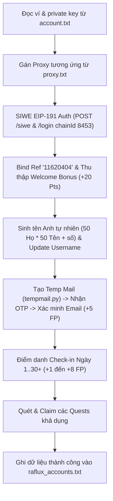

# HƯỚNG DẪN VẬN HÀNH RAFLUX AUTO BOT (BASE EVM)

Tài liệu hướng dẫn vận hành hệ thống bot tự động cày nhiệm vụ, điểm danh và khai thác điểm thưởng trên nền tảng **[Raflux.io](https://raflux.io/?ref=11620404)** sử dụng ví Base EVM.

---

## 🎯 1. ĐÁNH GIÁ CƠ CHẾ & KHẢ QUAN KHI CÀY FREE (0 ĐỒNG)

| Hành động | Điểm nhận được (FP/Points) | Yêu cầu phí gas / tiền nạp? |
| :--- | :---: | :---: |
| **Bind Referral & Welcome Bonus** | **+20 Points** | **FREE** (Chỉ ký EIP-191 off-chain) |
| **Xác minh Email (tempmail.py)** | **+5 FP** (Mở khóa toàn bộ quest board) | **FREE** (Dùng MailTM tự động lấy OTP) |
| **Điểm danh Daily Check-in** | **+1 đến +8 FP/ngày** (Chu kỳ Streak 30-365 ngày) | **FREE** (1 click API) |
| **Hoa hồng ví mẹ (Ref kickbacks)** | **Hưởng % điểm từ mạng lưới ref** | **FREE** |

* **Đánh giá:** Mỗi ví clone sau khi chạy kịch bản tự động sẽ gom ngay **26 Points/acc** trong ngày đầu tiên, và tích lũy đều đặn mỗi ngày từ Check-in Streak mà **không tốn 1 cắc phí gas**.

---

## 📁 2. CẤU TRÚC FILE HỆ THỐNG TRONG THƯ MỤC 

| Tên file | Mục đích |
| :--- | :--- |
| **`raflux.py`** | Script chính tự động toàn bộ: SIWE Login, Bind Ref, Đổi Username, Xác minh Email, Check-in Streak, Quests & Auto-Loop 24/7. |
| **`account.txt`** | Danh sách tài khoản EVM đầu vào (Tự động nhận diện `address` và `private_key` từ bất kỳ định dạng nào). |
| **`proxy.txt`** | Danh sách proxy xoay vòng để tránh chặn IP (`user:pass@ip:port` hoặc `ip:port:user:pass`). |
| **`tempmail.py`** | Client MailTM thread-safe tự động tạo mail và nhận mã OTP xác minh. |
| **`username.py`** | Module sinh username tự nhiên (English / Twitter / Telegram) tái sử dụng cho nhiều kèo. |
| **`raflux_accounts.txt`** | File xuất kết quả: `address|private_key|username|email|points|streak|status` (Tự động làm mới mỗi vòng lặp mới). |

---

### 🔹 Chạy tự động lặp theo chu kỳ 24/7 (Daemon Scheduler):
Bot sẽ tự động tính thời gian đếm ngược đến mốc reset ngày của hệ thống (`04:00 UTC` hàng ngày), hiển thị đồng hồ đếm ngược trực quan và tự động thức dậy điểm danh vòng mới:
```bash
python raflux.py
```

---

## ⚙️ 4. QUY TRÌNH TỰ ĐỘNG HÓA CHI TIẾT TRÊN MỖI TÀI KHOẢN



